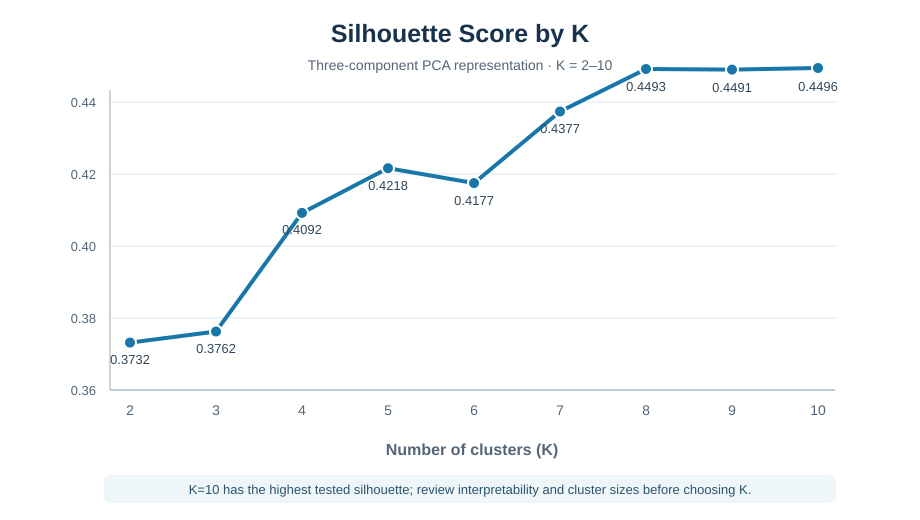
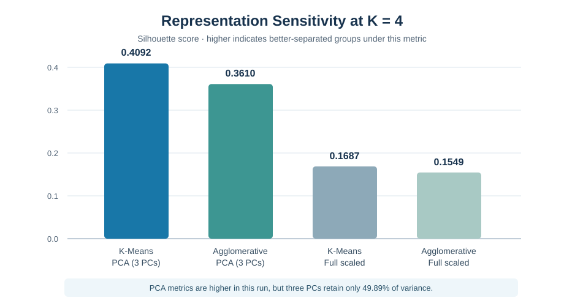
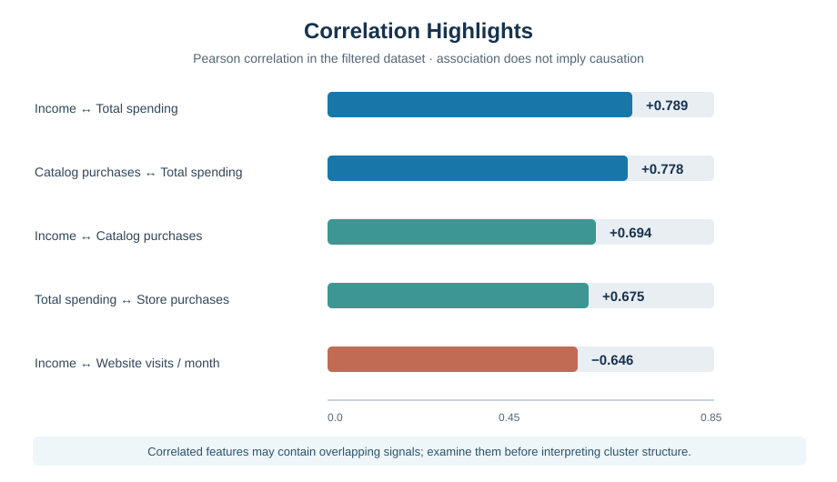

# SmartCart Customer Segmentation System

**Minor Project | Unsupervised Machine Learning | Customer Analytics**

An end-to-end exploratory customer segmentation project using data cleaning, feature engineering, correlation analysis, encoding, scaling, PCA, K selection, clustering, and cluster profiling.

## Problem statement

SmartCart has customer demographic, purchase behaviour, and engagement data, but generic marketing may overlook meaningful differences between customers. This project explores customer groups that could inform more focused engagement hypotheses. It is an unsupervised segmentation project, not a supervised churn predictor.

## Workflow

1. Inspect dataset shape, types, missing values, unique values, and duplicates.
2. Impute missing income values using the median.
3. Engineer age, customer tenure, total spending, and total children.
4. Drop identifiers and redundant original fields after feature engineering.
5. Inspect outliers with boxplots and apply documented project filters.
6. Explore numerical relationships with a correlation heatmap.
7. One-hot encode categorical features and scale the model matrix.
8. Apply PCA for dimensionality reduction and visualization.
9. Compare K candidates using WCSS/Elbow and Silhouette diagnostics.
10. Fit K-Means and Agglomerative Clustering.
11. Compare internal metrics and characterize clusters using original-scale statistics.

## Baseline results

- Input data: 2,240 rows and 22 columns.
- 24 missing values were found in `Income`; median imputation used 51,381.50.
- No duplicate complete rows were found.
- The documented age and income filters retained 2,236 customers.
- The first three principal components explain 49.89% of standardized feature variance.
- In the tested range K=2–10, the highest silhouette score occurred at K=10 (about 0.4496). K=4 is retained as the baseline for comparing the two algorithms; it is **not** claimed to be the optimal segmentation.

| Baseline model on 3-component PCA | K | Silhouette ↑ | Calinski–Harabasz ↑ | Davies–Bouldin ↓ |
|---|---:|---:|---:|---:|
| K-Means | 4 | 0.4092 | 1430.79 | 1.0363 |
| Agglomerative (Ward linkage) | 4 | 0.3610 | 1222.03 | 0.9144 |

The metrics do not unanimously favour a single model. Review segment profiles, stability, and business interpretability before selecting a final approach.

A four-cluster sensitivity check shows the following comparison:

| Feature representation | Algorithm | Silhouette | Calinski-Harabasz | Davies-Bouldin |
|---|---|---:|---:|---:|
| PCA (3 components) | K-Means | 0.4092 | 1430.79 | 1.0363 |
| PCA (3 components) | Agglomerative | 0.3610 | 1222.03 | 0.9144 |
| Full standardized features | K-Means | 0.1687 | 367.38 | 1.8156 |
| Full standardized features | Agglomerative | 0.1549 | 311.78 | 2.0260 |

For this run, internal metrics favour the PCA representation at K=4, but the three PCs retain only 49.89% of variance. Treat this as a representation trade-off, not proof that PCA is always better. The small K-Means seed check gave Adjusted Rand Index 1.0000 for seeds 42 vs 43 and 0.9968 for seeds 42 vs 44; this is only a small reproducibility check, not a full stability study.

## Visual results

### K selection: silhouette score



The highest silhouette in the tested K=2–10 range is K=10, but cluster count should also reflect interpretable profiles, practical cluster sizes, and stability.

### Feature-space sensitivity



For this run, the K=4 internal metrics are higher in the three-component PCA representation. The first three components retain 49.89% of variance, so compare interpretability and information retained before choosing the final representation.

### Correlation highlights



Income and total spending, catalog purchases and total spending, and purchase channel activity are strongly associated in the data. These relationships are descriptive and do not establish causation.

## Repository guide

- [Executed analysis notebook](notebooks/smartcart_customer_segmentation.ipynb)
- [Original notebook preserved for reference](notebooks/smartcart_original_notebook.ipynb)
- [Python implementation](src/smartcart_customer_segmentation.py)
- [Detailed project report (Markdown)](reports/SmartCart_Customer_Segmentation_Report.md)
- [Methodology and implementation decisions](docs/METHODOLOGY_AND_DECISIONS.md)
- [Generated results and tables](outputs/README.md)
- [Clustering metrics](outputs/tables/clustering_metrics.csv)
- [K-Means mean profiles](outputs/tables/kmeans_cluster_mean_profile.csv)

## Setup

Python 3.10+ is recommended.

```bash
python -m venv .venv
```

Activate the virtual environment, then:

```bash
python -m pip install -r requirements.txt
python src/smartcart_customer_segmentation.py
```

Or run `notebooks/smartcart_customer_segmentation.ipynb` from top to bottom.

## Important interpretation notes

Cluster IDs are arbitrary labels, not rankings. Assign business names only after examining the actual profile statistics. Silhouette and other internal scores describe geometric structure; they do not establish churn propensity, causal effects, marketing lift, or retention improvement. Compare PCA-space clustering with clustering on the full standardized feature matrix and check stability before making strong claims.

## Dataset licensing and privacy

The customer CSV was supplied for this project. Verify the source license, redistribution rights, and privacy implications before publishing the data publicly. If redistribution is not permitted, remove the CSV from the public repository and document how it can be obtained under its source terms. See [DATASET_NOTICE.md](DATASET_NOTICE.md) for the scope of the repository license and dataset-specific caution.

## References

- [Scikit-learn: Clustering](https://scikit-learn.org/stable/modules/clustering.html)
- [Scikit-learn: K-Means](https://scikit-learn.org/stable/modules/generated/sklearn.cluster.KMeans.html)
- [Scikit-learn: Agglomerative Clustering](https://scikit-learn.org/stable/modules/generated/sklearn.cluster.AgglomerativeClustering.html)
- [Scikit-learn: PCA](https://scikit-learn.org/stable/modules/generated/sklearn.decomposition.PCA.html)
- [Scikit-learn: Silhouette Score](https://scikit-learn.org/stable/modules/generated/sklearn.metrics.silhouette_score.html)
